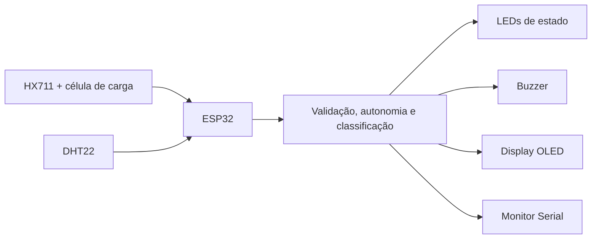

<div align="center">

# SmartPantry

**Sistema embarcado para monitoramento local de estoque e das condições de armazenamento de alimentos secos.**

[](https://docs.arduino.cc/)
[](https://docs.espressif.com/)
[](https://docs.platformio.org/)
[](https://docs.wokwi.com/)
[](#status-do-projeto)

</div>

## Sobre o projeto

O SmartPantry é um projeto acadêmico de Internet das Coisas que usa um ESP32 para acompanhar a quantidade disponível de um alimento seco e as condições do ambiente em que ele está armazenado.

Uma célula de carga conectada ao módulo HX711 fornece o peso, enquanto o DHT22 mede temperatura e umidade. O firmware calcula a autonomia estimada do estoque, classifica o cenário e comunica o resultado localmente por LEDs, buzzer, display OLED e Monitor Serial.

O projeto foi desenvolvido individualmente para a atividade substitutiva da **Global Solution 2026.2 (SUB GS)**, na disciplina **AI Computer Systems & Sensors (AICSS)** do curso de Inteligência Artificial da FIAP.

## Funcionalidades

- leitura de peso com HX711 e célula de carga;
- leitura de temperatura e umidade com DHT22;
- estimativa de autonomia com base no consumo diário configurado;
- classificação do cenário como `NORMAL`, `ATTENTION` ou `CRITICAL`;
- indicação visual por LEDs verde, amarelo e vermelho;
- alerta sonoro em estado crítico;
- exibição das medições no OLED SSD1306;
- relatório detalhado no Monitor Serial;
- validação de leituras ausentes, inválidas ou fora das faixas aceitas;
- estado crítico de segurança quando ocorre falha na leitura dos sensores.

## Arquitetura



Todo o processamento é realizado localmente pelo ESP32. O escopo final não inclui aplicação móvel, serviços em nuvem, banco de dados, Wi-Fi ou modelos de Machine Learning.

## Regras de funcionamento

### Autonomia estimada

```text
autonomia em dias = peso disponível / consumo diário
```

O consumo diário usado na demonstração é `0,3` unidade de peso por dia, definido por `DAILY_CONSUMPTION`. O fator de calibração da célula de carga é `420.0` e pode ser ajustado no firmware para outra montagem física.

### Classificação

O status geral corresponde à condição de maior gravidade encontrada entre autonomia, temperatura e umidade.

| Indicador | `NORMAL` | `ATTENTION` | `CRITICAL` |
|---|---:|---:|---:|
| Autonomia | acima de 5 dias | acima de 2 e até 5 dias | até 2 dias |
| Temperatura | abaixo de 30 °C | de 30 °C a menos de 40 °C | 40 °C ou mais |
| Umidade relativa | abaixo de 65% | de 65% a menos de 80% | 80% ou mais |

| Status | LED | Buzzer |
|---|---|---|
| `NORMAL` | verde | desligado |
| `ATTENTION` | amarelo | desligado |
| `CRITICAL` | vermelho | tom de 1 kHz por 500 ms a cada ciclo |

As leituras são atualizadas a cada 5 segundos. Os limites ambientais são parâmetros experimentais da demonstração acadêmica e não substituem critérios técnicos de conservação ou segurança alimentar.

## Hardware e conexões

O circuito completo está definido em [`diagram.json`](diagram.json) para execução no Wokwi.

| Componente | Conexão no ESP32 | Função |
|---|---|---|
| HX711 — DT | GPIO 16 | dados da célula de carga |
| HX711 — SCK | GPIO 17 | clock da célula de carga |
| DHT22 — DATA | GPIO 15 | temperatura e umidade |
| OLED — SDA | GPIO 21 | dados I²C |
| OLED — SCL | GPIO 22 | clock I²C |
| LED verde | GPIO 25 | estado normal |
| LED amarelo | GPIO 26 | estado de atenção |
| LED vermelho | GPIO 27 | estado crítico |
| Buzzer | GPIO 23 | alerta sonoro |

A montagem simulada também contém três resistores de `220 Ω` para os LEDs, um resistor de pull-up de `10 kΩ` no DHT22, protoboard, alimentação em `3,3 V` e terra comum. O display usa o endereço I²C `0x3C`.

## Tecnologias

- C++ com Arduino Framework;
- ESP32 Dev Module;
- PlatformIO;
- Wokwi para simulação do circuito;
- bibliotecas HX711, DHTesp, Adafruit GFX e Adafruit SSD1306.

As dependências são declaradas em [`platformio.ini`](platformio.ini) e instaladas automaticamente pelo PlatformIO.

## Estrutura do repositório

```text
smartpantry/
├── src/
│   └── main.ino       # firmware completo do ESP32
├── diagram.json       # componentes e conexões do circuito Wokwi
├── platformio.ini     # ambiente e dependências do PlatformIO
├── wokwi.toml         # artefatos usados pelo simulador
└── README.md          # documentação do projeto
```

## Como executar

### Pré-requisitos

- [Visual Studio Code](https://code.visualstudio.com/);
- extensão [PlatformIO IDE](https://platformio.org/install/ide?install=vscode);
- extensão [Wokwi para VS Code](https://docs.wokwi.com/vscode/getting-started).

### Compilação e simulação

1. Clone o repositório e acesse a pasta do projeto:

   ```bash
   git clone <URL_DO_REPOSITORIO>
   cd smartpantry
   ```

2. Instale as dependências e compile o firmware:

   ```bash
   pio pkg install
   pio run -e esp32
   ```

3. No VS Code, execute o comando **Wokwi: Start Simulator**.
4. Durante a simulação, altere o peso da célula de carga e os valores do DHT22.
5. Observe o OLED, os LEDs, o buzzer e o Monitor Serial em `115200 baud`.

O arquivo [`wokwi.toml`](wokwi.toml) carrega automaticamente os artefatos gerados em `.pio/build/esp32/`.

## Exemplo de saída serial

```text
========================
Status: ATTENTION
Peso: 1.20 kg
Temperatura: 25.0 C
Umidade: 50.0 %
Autonomia: 4.00 dias
[ATENCAO]  Estoque baixo! Autonomia: 4.00 dias
========================
```

Quando mais de um indicador ultrapassa seu limite, o Monitor Serial apresenta todos os motivos aplicáveis.

## Validação

Em **27 de novembro de 2026**, o firmware foi compilado com sucesso no ambiente `esp32` do PlatformIO:

| Verificação | Resultado |
|---|---|
| Compilação do firmware | sucesso |
| Uso de RAM | 23.960 bytes de 327.680 bytes — 7,3% |
| Uso de flash | 317.035 bytes de 1.310.720 bytes — 24,2% |

A compilação emite um aviso na formatação da linha de status do OLED. Esse aviso não impede a geração do firmware; as medições continuam sendo exibidas e o status permanece disponível pelos LEDs e pelo Monitor Serial.

## Status do projeto

O SmartPantry está **concluído no escopo acadêmico definido**. O repositório contém o firmware, o circuito simulado, a configuração de compilação e a documentação necessários para apresentação e avaliação.

O resultado representa uma prova de conceito simulada. Em uma instalação física, seria necessário calibrar e tarar a célula de carga para o recipiente utilizado. O DHT22 mede as condições do ar e não determina contaminação ou segurança do alimento para consumo.

## Relação com os ODS

- **ODS 2 — Fome Zero e Agricultura Sustentável:** apoio ao acompanhamento preventivo da disponibilidade de alimentos e ao planejamento de reposições.
- **ODS 12 — Consumo e Produção Responsáveis:** apoio à administração consciente do estoque e à redução potencial de desperdícios.

Essas relações representam objetivos potenciais da solução; não correspondem a impacto social mensurado neste projeto.

## Referências

- [Arduino Documentation](https://docs.arduino.cc/)
- [ESP32 Documentation — Espressif](https://docs.espressif.com/projects/esp-idf/en/latest/esp32/)
- [PlatformIO Documentation](https://docs.platformio.org/)
- [Wokwi Documentation](https://docs.wokwi.com/)
- [Objetivos de Desenvolvimento Sustentável — ONU Brasil](https://brasil.un.org/pt-br/sdgs)
