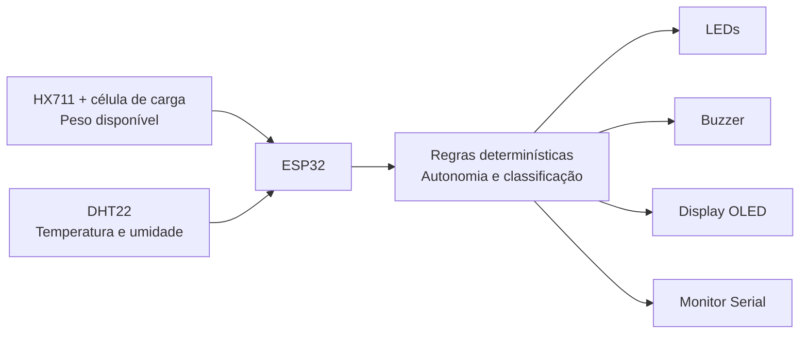

<div align="center">

# SmartPantry

**Protótipo CitizenTech para monitorar estoque e condições de armazenamento de alimentos secos.**

[](https://www.arduino.cc/reference/en/)
[](https://docs.espressif.com/)
[](https://docs.platformio.org/)
[](https://docs.wokwi.com/)
[](#status-de-desenvolvimento)

</div>

## Sumário

- [Sobre o projeto](#sobre-o-projeto)
- [Contexto acadêmico](#contexto-acadêmico)
- [Problema e público](#problema-e-público)
- [Arquitetura](#arquitetura)
- [Tecnologias e componentes](#tecnologias-e-componentes)
- [Regras de funcionamento](#regras-de-funcionamento-planejadas)
- [Estrutura do repositório](#estrutura-do-repositório)
- [Instalação e execução](#instalação-e-execução)
- [Status de desenvolvimento](#status-de-desenvolvimento)
- [Plano de testes](#plano-de-testes-futuro)
- [ODS, limitações e referências](#ods-limitações-e-referências)

## Sobre o projeto

O SmartPantry é uma proposta de dispositivo embarcado para acompanhar a quantidade disponível e as condições ambientais de armazenamento de alimentos secos, como arroz e feijão. A solução é idealizada como um recipiente sobre uma célula de carga, com leitura de temperatura e umidade e comunicação local ao usuário.

Os objetivos são monitorar o estoque, sinalizar condições potencialmente desfavoráveis e estimar a autonomia do alimento a partir de um consumo diário configurado. Não há integração prevista com serviços em nuvem, aplicativos, banco de dados ou modelos de Machine Learning.

## Contexto acadêmico

Projeto individual desenvolvido para a atividade substitutiva da **Global Solution 2026.2 (SUB GS)**, na disciplina **AI Computer Systems & Sensors (AICSS)** do curso de Inteligência Artificial da FIAP.

A entrega se concentra em sistemas embarcados e sensores. A tomada de decisão proposta usa regras determinísticas, cálculos matemáticos e estruturas condicionais, seguindo o fluxo:

> Fenômeno observado → sensores → ESP32 → processamento e decisão → alerta local

## Problema e público

O controle inadequado do estoque doméstico pode levar a compras emergenciais, falta de itens essenciais e desperdício. Temperatura e umidade inadequadas também podem ser um fator desfavorável ao armazenamento.

O público principal são famílias, especialmente aquelas em situação de vulnerabilidade econômica, que buscam planejar melhor a reposição de alimentos. A proposta também pode ser adaptada, futuramente, a cozinhas solidárias, bancos de alimentos, pequenas instituições de assistência social e pequenos estabelecimentos alimentícios. Essas são aplicações potenciais; não há impacto social mensurado neste repositório.

## Arquitetura



O ESP32 deverá realizar leituras periódicas, validar dados, converter a leitura da célula de carga em quilogramas, calcular a autonomia e classificar o cenário. Os LEDs, buzzer, OLED e Monitor Serial são as saídas locais planejadas.

## Tecnologias e componentes

### Tecnologias configuradas

| Tecnologia | Papel no projeto |
|---|---|
| C++ / Arduino Framework | Firmware embarcado |
| ESP32 | Processamento e controle |
| PlatformIO | Dependências e compilação |
| Wokwi | Simulação do circuito |
| Visual Studio Code | Ambiente de desenvolvimento |
| Git e GitHub | Versionamento e publicação |

As dependências declaradas em `platformio.ini`, sem versões fixadas, são:

```ini
bogde/HX711
beegee-tokyo/DHT sensor library for ESPx
adafruit/Adafruit GFX Library
adafruit/Adafruit SSD1306
```

### Componentes presentes no circuito

O quadro abaixo reflete `diagram.json`, que é a fonte de verdade da montagem simulada atual.

| Componente | Qtde. | Configuração/uso no circuito |
|---|---:|---|
| ESP32 DevKit C v4 | 1 | Microcontrolador simulado |
| Protoboard mini | 1 | Distribuição de alimentação e GND |
| HX711 com célula de carga | 1 | Tipo configurado como `5kg`; DT no GPIO 16 e SCK no GPIO 17 |
| DHT22 | 1 | Dados no GPIO 15 |
| OLED SSD1306 | 1 | I²C, endereço `0x3c`; SCL no GPIO 21 e SDA no GPIO 22 |
| LED verde | 1 | GPIO 25, resistor de 1 kΩ |
| LED amarelo | 1 | GPIO 26, resistor de 1 kΩ |
| LED vermelho | 1 | GPIO 27, resistor de 1 kΩ |
| Buzzer | 1 | GPIO 23 |

## Regras de funcionamento planejadas

### Autonomia estimada

```text
Autonomia (dias) = peso disponível (kg) / consumo diário (kg)
```

A premissa planejada é consumo diário de **0,3 kg**. Por exemplo, 3 kg equivaleriam a 10 dias de autonomia. Esse valor é configurável para demonstração e não representa recomendação nutricional ou consumo familiar universal.

### Classificação

O maior nível de gravidade entre autonomia, temperatura e umidade deverá determinar o status geral. Condições críticas devem ser avaliadas antes das condições de atenção.

| Indicador | NORMAL | ATENÇÃO | CRÍTICO |
|---|---|---|---|
| Autonomia | Acima de 5 dias | Acima de 2 até 5 dias | Até 2 dias |
| Temperatura | Abaixo de 30 °C | 30 a menos de 40 °C | 40 °C ou mais |
| Umidade relativa | Abaixo de 65% | 65 a menos de 80% | 80% ou mais |

| Situação | LED esperado | Buzzer esperado |
|---|---|---|
| NORMAL | Verde | Desligado |
| ATENÇÃO | Amarelo | Desligado |
| CRÍTICO | Vermelho | Alerta sonoro periódico |

Os limites ambientais são parâmetros experimentais da demonstração acadêmica, não critérios cientificamente validados de conservação ou segurança alimentar.

O intervalo de leitura planejado é de **5 segundos** (`READ_INTERVAL = 5000`). Caso seja usado `delay()`, o período efetivo também incluirá o tempo gasto no processamento e na comunicação.

### Saída serial esperada

Quando a lógica estiver implementada e validada, a saída deverá apresentar o status antes dos dados medidos, em formato semelhante a este exemplo:

```text
----------------------------
STATUS: ATENCAO
Peso: 1.20 kg
Temperatura: 25.0 C
Umidade: 50.0 %
Autonomia: 4.00 dias
Alerta: estoque reduzido
----------------------------
```

Este bloco é uma referência de saída esperada, e não evidência de execução atual.

## Estrutura do repositório

```text
smartpantry/
├── src/
│   └── main.ino       # Firmware Arduino (inicial)
├── diagram.json       # Circuito e conexões do Wokwi
├── platformio.ini     # Ambiente ESP32 e dependências PlatformIO
├── wokwi.toml         # Caminhos de firmware usados pelo Wokwi
└── README.md          # Documentação do projeto
```

O `wokwi.toml` aponta para `.pio/build/esp32/firmware.elf` e `.pio/build/esp32/firmware.bin`, correspondentes ao ambiente `[env:esp32]` do PlatformIO.

## Instalação e execução

> O procedimento abaixo é destinado à execução após a conclusão e correção do firmware. O estado atual ainda não permite afirmar compilação ou simulação bem-sucedida.

### Pré-requisitos

- [Visual Studio Code](https://code.visualstudio.com/)
- Extensão [PlatformIO IDE](https://platformio.org/install/ide?install=vscode)
- Extensão oficial [Wokwi para VS Code](https://docs.wokwi.com/vscode/getting-started)
- [Git](https://git-scm.com/)

### Fluxo

1. Clone o repositório usando a URL publicada:

   ```bash
   git clone <URL_DO_REPOSITORIO>
   cd smartpantry
   ```

2. Abra a pasta no VS Code.
3. Instale as dependências e compile o ambiente `esp32`:

   ```bash
   pio pkg install
   pio run -e esp32
   ```

4. No VS Code, execute **`Wokwi: Start Simulator`**.
5. Altere as entradas disponíveis na simulação e acompanhe o Monitor Serial.

O fluxo documentado é exclusivamente simulado; não inclui upload para placa física.

## Status de desenvolvimento

O circuito Wokwi está definido em `diagram.json`, mas o firmware em `src/main.ino` contém apenas inclusões de bibliotecas, definições de GPIO e constantes iniciais. `setup()` atualmente apenas inicia a Serial e imprime uma mensagem; `loop()` executa `delay(10)`. Não há evidência no repositório de leitura de sensores, cálculo, classificação, controle de atuadores, OLED ou testes executados.

- [x] Definir o circuito simulado no Wokwi
- [x] Configurar ambiente ESP32, Arduino e dependências no PlatformIO
- [x] Declarar pinos e limites iniciais no firmware
- [ ] Inicializar e ler HX711
- [ ] Inicializar e ler DHT22
- [ ] Calibrar/tarar e converter peso em quilogramas
- [ ] Calcular autonomia
- [ ] Classificar NORMAL, ATENÇÃO e CRÍTICO
- [ ] Acionar LEDs e buzzer
- [ ] Exibir dados no OLED e no Monitor Serial
- [ ] Tratar leituras inválidas e oscilações
- [ ] Compilar e validar os cenários de teste

### Divergências identificadas

- A estrutura usa `src/main.ino`, e não `src/main.cpp`.
- `DAILY_CONSUMPTION` está escrito como `0,3` no firmware. Em C++, o separador decimal deve ser ponto (`0.3`); portanto, o código atual requer correção antes de uma compilação válida.
- O circuito usa uma placa `board-esp32-devkit-c-v4`, enquanto o PlatformIO está configurado com `board = esp32dev`.
- O circuito possui resistores de **1 kΩ** nos LEDs, não 220 Ω, e não declara resistor de pull-up externo de 10 kΩ para o DHT22.
- No circuito, o OLED usa SCL no GPIO 21 e SDA no GPIO 22; os nomes das constantes `OLED_SDA` e `OLED_SCL` no firmware estão invertidos em relação a essa ligação. Como o I²C ainda não foi inicializado no código, não há comportamento validado.

Esses pontos são registros de documentação; nenhum arquivo de circuito, configuração ou firmware foi alterado.

## Plano de testes futuro

Os cenários abaixo são um plano de validação da implementação, não resultados já obtidos.

| Cenário | Peso | Temperatura | Umidade | Status esperado |
|---|---:|---:|---:|---|
| Operação normal | 3 kg | 25 °C | 50% | NORMAL |
| Estoque reduzido | 1,2 kg | 25 °C | 50% | ATENÇÃO |
| Estoque crítico | 0,3 kg | 25 °C | 50% | CRÍTICO |
| Temperatura elevada | 3 kg | 35 °C | 50% | ATENÇÃO |
| Temperatura crítica | 3 kg | 42 °C | 50% | CRÍTICO |
| Umidade elevada | 3 kg | 25 °C | 70% | ATENÇÃO |
| Umidade crítica | 3 kg | 25 °C | 85% | CRÍTICO |
| Múltiplas condições críticas | 0,3 kg | 42 °C | 85% | CRÍTICO |
| Reposição do estoque | 5 kg | 25 °C | 50% | NORMAL |

## ODS, limitações e referências

### Objetivos de Desenvolvimento Sustentável

- **ODS 2 — Fome Zero e Agricultura Sustentável:** a proposta busca apoiar o acompanhamento preventivo da disponibilidade de alimentos e o planejamento de reposições.
- **ODS 12 — Consumo e Produção Responsáveis:** a proposta busca apoiar a administração consciente de estoques e a redução potencial de desperdícios.

As relações acima descrevem objetivos e potenciais benefícios; não são impactos medidos.

### Limitações

- A execução prevista é simulada no Wokwi; o recipiente físico não é representado integralmente.
- Uma implementação física exigiria calibração e tara da célula de carga.
- O consumo diário é fixo e configurável; a estimativa não acompanha mudanças de hábito familiar.
- Os limites de temperatura e umidade são experimentais.
- O DHT22 mede o ar do ambiente, não a qualidade do alimento, e o dispositivo não determina contaminação ou segurança para consumo.
- Não há armazenamento persistente, comunicação Wi-Fi, serviços externos ou alertas remotos.

### Referências técnicas

- [Documentação do PlatformIO](https://docs.platformio.org/)
- [Documentação do Wokwi](https://docs.wokwi.com/)
- [Documentação do Arduino](https://docs.arduino.cc/)
- [Documentação ESP32 da Espressif](https://docs.espressif.com/projects/esp-idf/en/latest/esp32/)
- [Objetivos de Desenvolvimento Sustentável — ONU Brasil](https://brasil.un.org/pt-br/sdgs)
